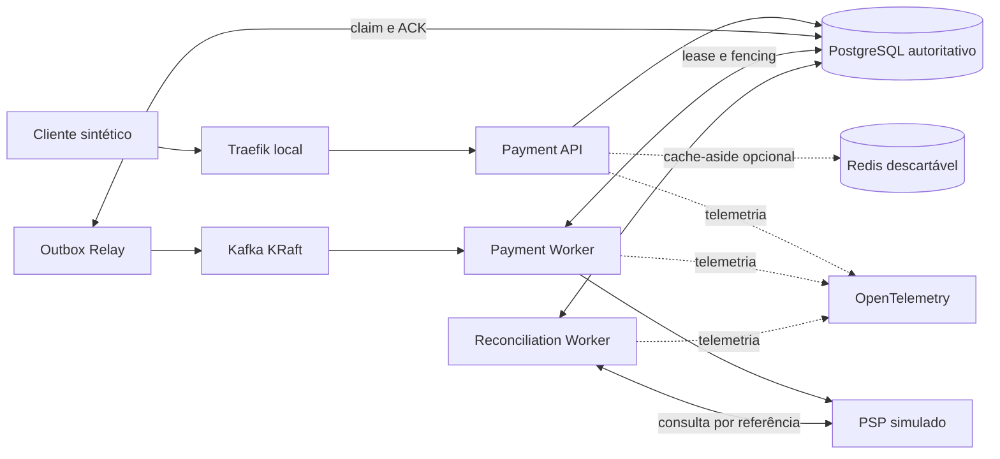

# Arquitetura

Cada aplicação seguirá arquitetura hexagonal: domínio e casos de uso no centro, portas próprias e adaptadores nas bordas. O domínio não importará Spring, Kafka, persistência ou SDK Azure. `shared-contracts` conterá somente DTOs e eventos versionados.

PostgreSQL será autoridade para pagamentos, idempotência, estados, Outbox, Inbox, leases e fencing. Redis será opcional e apenas para leituras não críticas. A entrega será at-least-once, sem alegação de exactly-once entre banco, Kafka e PSP.

## Fluxo planejado

1. API reserva atomicamente a idempotência e grava pagamento + Outbox na mesma transação.
2. Relay publica `payment.requested` e marca após ACK.
3. Worker deduplica via Inbox, adquire lease/fencing e persiste `SENT_TO_PSP` antes da chamada externa.
4. Timeout após envio vira `UNKNOWN`; o reconciliador consulta a referência antes de decidir.

## Local para Azure

| Local | Futuro Azure | Limite |
|---|---|---|
| Traefik | API Management | Gateway self-hosted não é APIM offline. |
| Containers | AKS | Não provisionado nesta fase. |
| PostgreSQL | Flexible Server | Banco continua autoritativo. |
| Kafka KRaft | Event Hubs Kafka | Compatibilidade parcial; sem presumir transações gerais. |
| Keycloak | Entra ID | Keycloak é laboratório OIDC. |
| OTel/Grafana | Azure Monitor | Telemetria local primeiro. |
| Azurite | Blob Storage | Emulador não integral. |
| Redis | Azure Managed Redis | Cache auxiliar e descartável. |

O perfil `local` será baseline; `cache`, `observability`, `security`, `azure-emulator` e `loadtest` serão opt-in.
